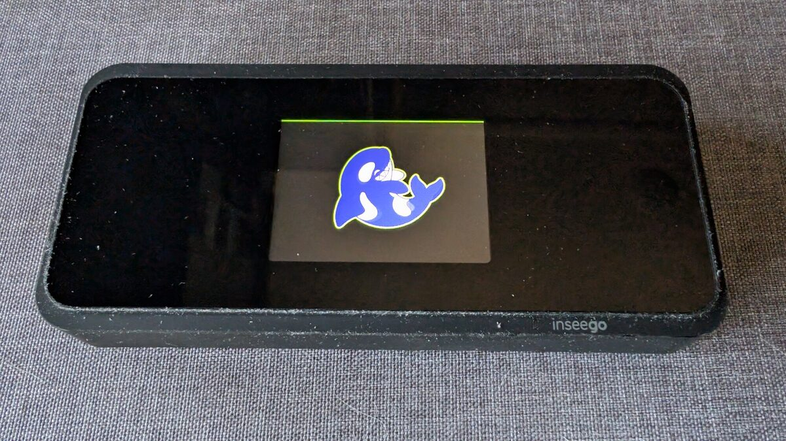
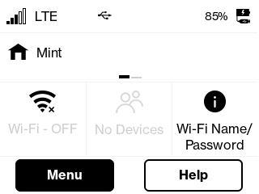
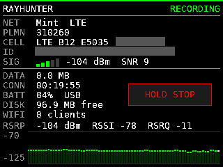
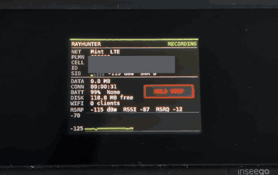
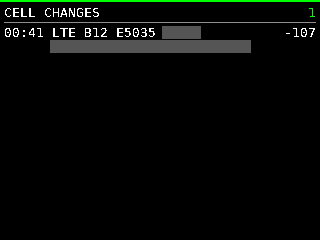
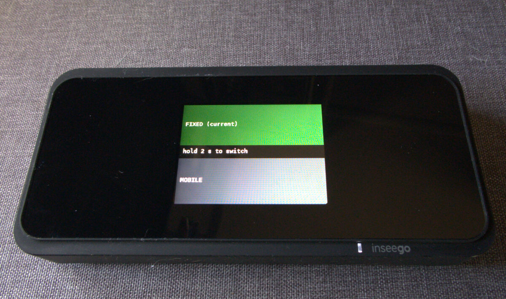
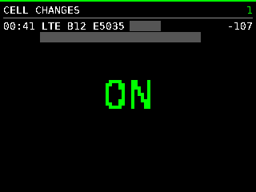
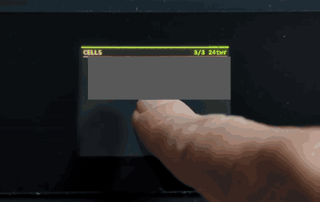
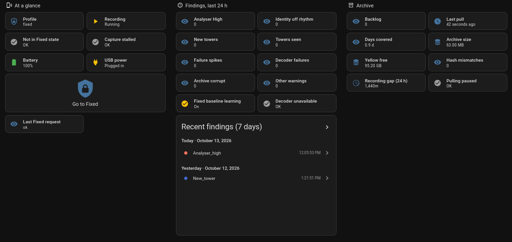
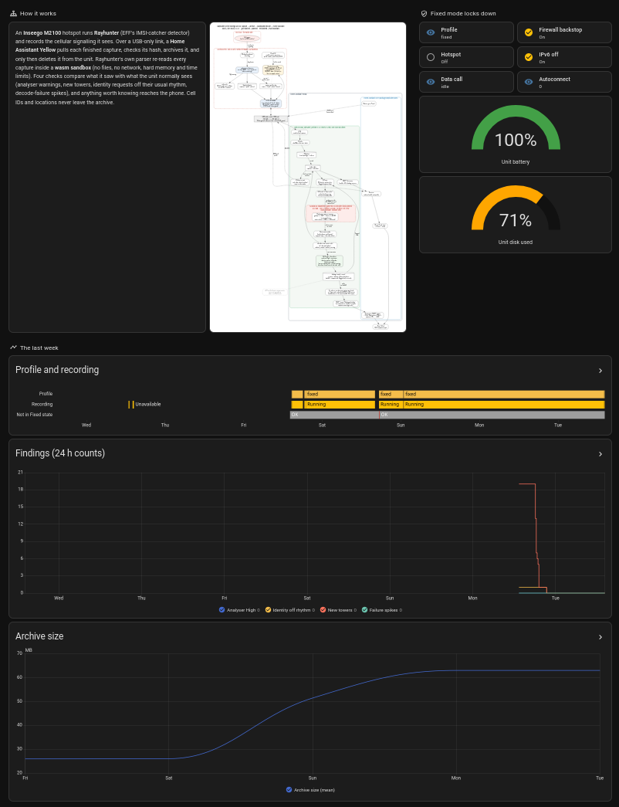

# A tour of the M2100 build

What this fork adds to Rayhunter on the Inseego M2100, and why. This is a tour, not a manual: each
section ends with a link to the doc that tells you how to set it up.

## Cheat sheet

| I want to... | Do this | More |
| --- | --- | --- |
| See Rayhunter | perform your reveal gesture on the stock home screen | [Reveal gesture](#the-reveal-gesture) |
| Hide it again | hold the corner of the screen you're on for 3 s | [Hidden screens](#the-hidden-screens) |
| Switch screens | hold a corner for 3 s (top-left cell log, top-right orca, bottom-left EFF, bottom-right status) | [Hidden screens](#the-hidden-screens) |
| Stop or start recording | status screen: hold the red/green button | [Hidden screens](#the-hidden-screens) |
| Open settings | left edge, halfway down, hold 3 s | [Settings](#settings) |
| See whether ADB and the web UI are open | tap the middle of the screen | [Lockdown](#lockdown-close-the-doors-for-ten-minutes) |
| Close them for ten minutes | hold the middle of the screen for 5 s | [Lockdown](#lockdown-close-the-doors-for-ten-minutes) |
| Lock it down for real | press the power button 5 times within 3 s (panic must be armed) | [Panic lockdown](#panic-lockdown) |
| Unlock after a panic | hold your PIN digits on the invisible 3×3 grid, half a second each | [Panic lockdown](#panic-lockdown) |
| Watch it from home | Home Assistant dashboards, fed by the add-on | [Home Assistant add-on](#the-home-assistant-add-on) |

## It looks like a hotspot

Most of the time the M2100 shows Inseego's own home screen and behaves like any other MiFi. Rayhunter
records underneath it; nothing on the screen says so. The one outward sign is the LED, which blinks a
little slower when recording is paused (about every 6 s instead of every 5). That gap is the signal:
on a device with one LED, counting is the only comparison you have.

## The reveal gesture

Rayhunter's screens stay hidden until you perform **your own** gesture on the stock home screen:
5 to 8 moves, each a swipe (up, down, left, right) or a touch at the left, middle or right of the top
strip. You choose it; nothing on the device hints that it exists, and the unit keeps only a salted
hash of it (the panic PIN too), so pulling the file off the unit doesn't give it away. Until you set one, nothing on the panel reveals Rayhunter at all.

You enrol it over USB (`./rayhunter-m2100 enroll gesture`) and the LED talks you through it: a blink
per move recognised, two blinks for "now do it again", a long glow when it's saved.

**Set it up:** [`dist/m2100/INSTALL-gesture.md`](dist/m2100/INSTALL-gesture.md), "Set the gesture".

## The hidden screens

The gesture always opens the **status** screen. From any Rayhunter screen, hold a corner for three
seconds to move to that corner's screen; hold the corner of the screen you're already on to hide
Rayhunter and bring back the stock screen.

| Corner | Screen |
| --- | --- |
| bottom-right | status |
| top-left | cell log |
| top-right | orca |
| bottom-left | EFF logo |

**Status** shows the network, the serving cell and band, signal (RSRP, RSSI, RSRQ, SNR) with a
sparkline, data used, battery, free space and Wi-Fi clients. The red **HOLD STOP** button stops
recording; held again (green, **HOLD START**) it starts a new one.

 

**Cell log** lists every change of serving cell with its time, band and signal: the first place to
look when something odd happens.

**Orca**: Rayhunter's mascot. A short tap switches between the spinning mascot and a swimming pod.
It's the screen to leave up if someone glances over; it reads as a sticker, not a tool.

 

### Settings

Hold the left edge, halfway down, for three seconds. Four rows: change the gesture, buzzer on/off,
the **Fixed / Mobile** profile, and the panic PIN. Settings close by themselves after 30 s untouched.

The profile decides whether the unit uses cellular data. **Fixed** is for a sentinel on a shelf: cellular
data and the Wi-Fi hotspot off, and a firewall that blocks anything leaving over cellular (IPv4 and
IPv6), so alerts go only to the screen and to Home Assistant. **Mobile** is for carrying it: data on,
so ntfy alerts go out. Hold FIXED or MOBILE for two seconds to switch.

**Set it up:** [`dist/m2100/INSTALL-gesture.md`](dist/m2100/INSTALL-gesture.md), "Settings" and
"Fixed or Mobile profile".

## Lockdown: close the doors for ten minutes

ADB and the web UI are the two ways in over a cable. On any Rayhunter screen:

- **tap the middle** to see whether they're open: a big **ON** or **OFF**, then back to where you were;
- **hold the middle for five seconds** to close them (or open them again).

A lockdown reverts by itself after ten minutes unless you hold the middle again, which restarts the
clock. That floor is deliberate: the touchscreen is the only way back once ADB is closed, and on this
hardware the panel once stopped responding, which left no way back at all.

 

## Panic lockdown

For the moment you don't want to be fiddling with a touchscreen: **press the power button five times
within three seconds**. No Rayhunter screen needs to be showing, and to anyone watching it looks like
someone prodding a hotspot that won't wake up.

What it does, in order:

1. stops the recording;
2. closes ADB and the web interface, with **no** ten-minute floor;
3. hides Rayhunter and leaves the stock screen;
4. confirms only with things the device does anyway: fast LED blinks, and Inseego's own startup chime
   if your sound settings allow it. Never a Rayhunter-specific sound, which would be a tell at the one
   moment it matters.

It survives a reboot. Someone who takes the unit, power-cycles it and plugs in a cable finds a MiFi
with no ADB and no web interface, and every Rayhunter gesture is switched off.

**Unlocking.** While locked, the whole screen is an invisible 3×3 grid, numbered 1 to 9 left to right,
top to bottom. Hold each digit of your PIN for half a second. Nothing is drawn and nothing answers a
wrong digit; the right PIN unlocks it. Use 6 to 8 digits: the pad checks a rolling window, so a
guesser gets a fresh try every digit, and six digits is about six days of continuous guessing where
four is under two hours.

**What it protects, and what it doesn't.** It defeats *inspection*: a quick look, a cable, a power
cycle. It does not defeat *forensics*: the captures are unencrypted on flash, and anyone who reads
the flash directly has them.

### Arming it

Panic lockdown is **off** until you set a panic PIN; setting the PIN is the arming.

1. Reveal Rayhunter with your gesture.
2. Hold the left edge for three seconds to open settings.
3. Tap the bottom row, **set panic PIN**.
4. Enter 6 to 8 digits on the invisible 3×3 pad (hold each for half a second), pause, then enter them
   again. The screen shows "Saved".

Check it over USB with `./rayhunter-m2100 status` ("panic PIN: armed").

**Rehearse first.** Add a line `dev = true` to `/data/rayhunter/.panic` (over ADB, after setting the PIN).
In rehearsal mode the panic sequence stops recording, hides Rayhunter and locks the screen to the PIN
pad, but leaves ADB open, so a fumbled PIN costs a daemon restart, not the device. Remove the line
when you're confident.

> [!WARNING]
> **Forget the PIN while locked, or lose the touchscreen, and the only way back is a reflash.** There
> is no ADB and no web UI to recover through. `./rayhunter-m2100 reset pin` disarms it, but only over
> ADB, so only while the unit is *not* locked.

**Set it up:** [`dist/m2100/INSTALL-gesture.md`](dist/m2100/INSTALL-gesture.md), "Set the panic PIN".

## The Home Assistant add-on

The unit on the shelf records; the add-on on the Home Assistant box does the thinking. Every
15 minutes it pulls the captures off the unit over USB, verifies them, keeps them on the Home
Assistant box and only then deletes them from the unit. Then it:

- decodes each capture in a sandbox (the decoder is WebAssembly, with no files and no network);
- judges it against a baseline it learns of your own towers: new towers, towers that come and go
  off their usual rhythm, Rayhunter's own analyser findings;
- groups strong findings into one alert at a time, and tells your phone;
- reports health to Home Assistant over MQTT: recording gaps, backlog, disk, decoder trouble;
- offers a **Fixed** button, which can move the unit to the Fixed profile and do nothing else
  (paired with `./rayhunter-m2100 pair`).

Optional extras: output to Cribl, a Meshtastic radio so a household hears alerts even with the
internet down, and a short plain-language summary of an alert's evidence. The add-on also has its own
**Sentinel** panel in the Home Assistant sidebar (alert status, follow-up presets, a log of what was
sent).

**Set it up:** [`m2100-archive/README.md`](m2100-archive/README.md) (cheat sheet at the top).

---

Rayhunter is EFF's project; this fork and its M2100 support are not affiliated with or endorsed by
EFF. See the [README](README.md) before you try any of this, especially "Before you try this".
