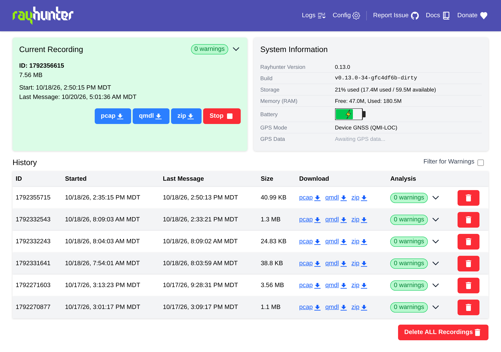
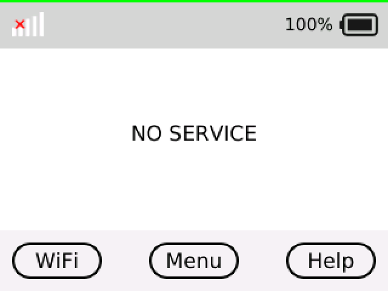
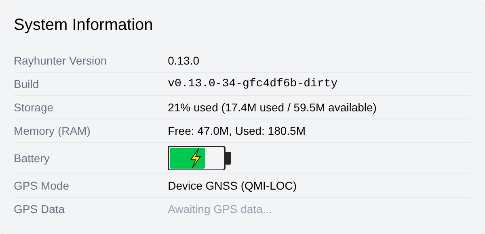

# Rayhunter on the Orbic R500L5 (proof of concept)

This branch runs [EFF's Rayhunter](https://github.com/EFForg/rayhunter) on the **Orbic R500L5**, a Verizon 5G
hotspot built on the Qualcomm **SDX55**. Upstream Rayhunter doesn't support this device. The changes here are what
it took to get it recording, analyzing and tagging recordings with the device's own GNSS positions. Two units
(firmware `V2.0.3.9_BVZRT` and `V2.0.4.3_BVZRT`) run this build.

> **Status: proof of concept.** This is not an EFF release, and the EFF project doesn't support it. Please don't
> report problems with this branch upstream. The plan is to propose the changes upstream one at a time (see
> [Upstreaming](#upstreaming)). Until then, expect rough edges and a manual install.

| Web UI (recording) | LCD (Rayhunter's status line over the stock UI) |
|---|---|
|  |  |



*Storage is the `/cache` volume. The unit was indoors without sky view, so the GPS row is waiting for a fix.*

## What works

- **Recording and analysis** with the stock analyzers, from the kernel `/dev/diag` interface (4.14 kernel).
- **Web UI** on port 8080 over the USB tether: status, start/stop, and pcap / QMDL / zip downloads.
- **LCD:** with `ui_level = 1`, Rayhunter draws its colored status line over the stock Qt UI on the 320x240 panel.
- **Battery** level and charging state.
- **GNSS positions in recordings**, read directly from the modem's location engine over QMI-LOC (`gps_mode = 4`), or
  from NMEA sentences sent to a local UDP port (`gps_mode = 3`).
- **Storage:** recordings live on the 81 MB `/cache` volume instead of the 24 MB `/data`. With the high-volume
  `0xB114` log code excluded, a unit writes about 10 KiB/min, so `/cache` holds roughly five days.
- **All RATs, all bands:** the factory configuration is already unlocked (`AT+WS46?` reads `38`: UTRAN, E-UTRAN and
  NR). Don't add a RAT or band lock: a cell-site simulator often works by pushing the phone to another RAT or band.

## What changed

18 commits on top of upstream `main`. Each one is self-contained and has a full explanation in its commit message.

| Area | Commit | Why the R500L5 needed it |
|---|---|---|
| DIAG | `lib/diag: unwrap DIAG_MULTI_RADIO_CMD_F (0x98) envelopes` | Every log packet on the SDX55 arrives inside a `0x98` envelope, so nothing was parsed or recorded |
| DIAG | `diag_device: fall back to the 24-byte SWITCH_LOGGING layout on newer kernels` | The 4.14 diagchar driver reads a 24-byte parameter struct and rejected the short one |
| DIAG | `lib/diag: parse 0xB114 … v0xA1`, `lib/diag: parse 0xB063 … v0x31` | The SDX55 logs new versions of these codes; every record failed and was logged as skipped |
| DIAG | `config: add excluded_log_codes …` | `0xB114` is about two thirds of all log packets; excluding it makes the storage last |
| Device | `Add an r500l5 device, split from orbic` | `device = "r500l5"`, so later changes can target it without touching the RC400L |
| Device | `display/orbic: read the framebuffer geometry …` | The panel is 320x240 with a 640-byte line, not 128x128 |
| Device | `daemon/battery: read power_supply …` | No `/sys/kernel/chg_info`; the standard `power_supply` class is used instead |
| Device | `lib/sim: fall back to plain reads and writes …` | The AT port `/dev/smd7` is an SMD packet device, not a tty |
| GPS | `gps: add an NMEA-over-UDP GPS mode`, `gps: listen for NMEA on loopback …`, `web: shorten …` | `gps_mode = 3`, loopback by default, checksums required |
| GPS | `gps: add a QMI-LOC mode …` | `gps_mode = 4`: positions from the device's own GNSS engine, no forwarder |
| Robustness | `qmdl_store: never reuse a recording name` | Without network time, the clock boots to the same value and a new recording overwrote an old one |
| Robustness | `daemon: record the final QMDL size …`, `daemon: close a running recording …` | Manifest sizes were wrong after stop/exit |
| Robustness | `diag: report a refused start that has no caller` | A startup recording refused for low space failed silently |
| UI | `Show a build id alongside the version` | Custom builds are identifiable in the web UI |

`gps_mode = 4` uses `third_party/qmiloc`, a small Apache-2.0 QMI-LOC client crate vendored into the tree.

## Installing (manual)

There is no installer for this device yet. You need a root shell on the R500L5 and some comfort with systemd. The
web-admin route Rayhunter's installer uses on the RC400L also works on R500L5 firmware `V2.0.3.9_BVZRT` and
`V2.0.4.3_BVZRT`, but the installer doesn't drive it for this device.

1. **Build** the daemon (see [Installing from source](doc/installing-from-source.md) for the toolchain). The web UI is
   embedded, so build it first:

   ```sh
   (cd daemon/web && npm install && npm run build)
   cargo build-daemon-firmware-devel
   ```

2. **Copy** `target/armv7-unknown-linux-musleabihf/firmware-devel/rayhunter-daemon` to
   `/data/rayhunter/rayhunter-daemon` on the device, and the config below to `/data/rayhunter/config.toml`
   ([Porting](doc/porting.md) describes copying files with `netcat` or `adb push`).

3. **Move storage to `/cache`:** `mkdir -p /cache/rayhunter/qmdl`. The web UI's log view reads
   `/data/rayhunter/rayhunter.log`, so link it: `ln -sf /cache/rayhunter/rayhunter.log /data/rayhunter/rayhunter.log`.

4. **Install the service** below as `/etc/systemd/system/rayhunter.service`, then `systemctl daemon-reload`,
   `systemctl enable rayhunter`, and **reboot**. Rayhunter has to be the first `/dev/diag` client after boot.

`/data/rayhunter/config.toml`:

```toml
qmdl_store_path = "/cache/rayhunter/qmdl"
port = 8080
debug_mode = false
colorblind_mode = false
device = "r500l5"
ui_level = 1
key_input_mode = 0
enabled_notifications = ["Warning", "LowBattery"]
auto_check_updates = false
clock_sync_mode = 2
min_space_to_start_recording_mb = 8
min_space_to_continue_recording_mb = 6
wifi_enabled = false
# Positions from the device's own GNSS engine over QMI-LOC
gps_mode = 4
# 0xB114 is most of the recorded bytes on the SDX55. Keep this line ABOVE [analyzers],
# or TOML puts it inside that table and the daemon refuses the config.
excluded_log_codes = [0xb114]

[analyzers]
imsi_requested = true
connection_redirect_2g_downgrade = true
lte_sib6_and_7_downgrade = true
null_cipher = true
nas_null_cipher = true
incomplete_sib = true
test_analyzer = false
diagnostic_analyzer = true
no_nas_messages = false
```

`/etc/systemd/system/rayhunter.service`:

```ini
[Unit]
Description=Rayhunter (EFF IMSI-catcher detector)
After=network.target local-fs.target
# Recordings and the daemon log live on /cache (81 MB) rather than /data (24 MB).
RequiresMountsFor=/cache

[Service]
Type=simple
# The modem's DIAG peripheral registers some time after /dev/diag appears; start late.
ExecStartPre=/bin/sh -c 'while [ "$(cut -d. -f1 /proc/uptime)" -lt 90 ]; do sleep 5; done'
ExecStart=/bin/sh -c 'RUST_LOG=info,rayhunter::diag_device=warn,asn1_codecs=error exec /data/rayhunter/rayhunter-daemon /data/rayhunter/config.toml >> /cache/rayhunter/rayhunter.log 2>&1'
# SIGINT is the daemon's clean shutdown. A blocking /dev/diag read can hang it, so let systemd SIGKILL after 10 s.
KillSignal=SIGINT
TimeoutStopSec=10
# Taking /dev/diag over again mid-boot can leave modem log delivery dark until a reboot.
Restart=no

[Install]
WantedBy=multi-user.target
```

## Known issues and open work

**Hardware**

- **Long-term external power:** a unit left on external power goes into a battery-protection mode and stops
  charging the battery. A unit that stays in one place needs a workaround; none is in place yet.
- **Over-the-air updates share `/cache`** with the recordings, so an OTA download can fill it. Blocking OTA on a
  dedicated unit is advisable; this branch doesn't do it for you.
- One unit once failed to come back from a software reboot and needed a power cycle.

**Software**

- **Clock:** with no SIM attach there is no network time, and the device boots to a saved clock that can be days
  behind. Recording names no longer collide, but their timestamps are wrong until the clock is set.
- **GNSS:** after a boot the engine can send no NMEA for about two minutes; the daemon restarts its session every
  30 s until sentences flow. A fix needs sky view.
- **DIAG ownership:** Rayhunter must be the only `/dev/diag` client. Another DIAG tool taking the device over can
  leave modem log delivery dark until a reboot.
- **Power button:** `key_input_mode` double-tap hasn't been verified on this hardware.
- **Before upstreaming:** the 24-byte `SWITCH_LOGGING` commit still logs each attempt at `info`, and `cargo fmt`
  wants changes in `lib/src/diag_device.rs` and `third_party/qmiloc`.

## Upstreaming

The plan is small, separate PRs to `EFForg/rayhunter`, each cherry-picked from this branch and tested on an RC400L
for regressions: first the DIAG parsing fixes (`0x98`, `0xB114`, `0xB063`) and the recording-robustness fixes, then
the device support (display geometry, battery, SIM, the 24-byte ioctl), then the GPS modes. The separate
`device = "r500l5"` value is a discussion for the maintainers, not a given.

## Credits

This port was developed by Luke Jenkins with the assistance of Claude (Anthropic's AI model), which helped with the
reverse engineering, the code, testing on the two units, and this write-up.

Rayhunter is EFF's project and is licensed GPL-3.0. The vendored `qmiloc` crate is Apache-2.0.

---

*The upstream README follows.*

# Rayhunter


Rayhunter is a project for detecting IMSI catchers, also known as cell-site simulators or stingrays. It was first designed to run on a cheap mobile hotspot called the Orbic RC400L, but thanks to community efforts, it can [support some other devices as well](https://efforg.github.io/rayhunter/supported-devices.html).
It's also designed to be as easy to install and use as possible, regardless of your level of technical skills, and to minimize false positives. 

&rarr;  Check out the [installation guide](https://efforg.github.io/rayhunter/installation.html) to get started.

&rarr; To learn more about the aim of the project, and about IMSI catchers in general, please check out our [introductory blog post](https://www.eff.org/deeplinks/2025/03/meet-rayhunter-new-open-source-tool-eff-detect-cellular-spying). 

&rarr; For discussion, help, or to join the mattermost channel and get involved with the project and community check out the [many ways listed here](https://efforg.github.io/rayhunter/support-feedback-community.html)!

&rarr; To learn more about the project in general check out the [Rayhunter Book](https://efforg.github.io/rayhunter/).

**LEGAL DISCLAIMER:** Use this program at your own risk. We believe running this program does not currently violate any laws or regulations in the United States. However, we are not responsible for civil or criminal liability resulting from the use of this software. If you are located outside of the US please consult with an attorney in your country to help you assess the legal risks of running this program.

*Good Hunting!*
